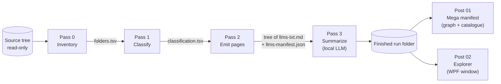
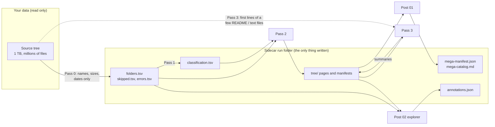
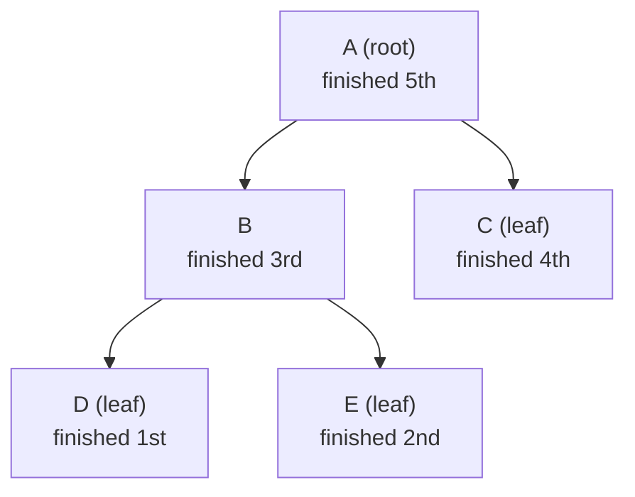
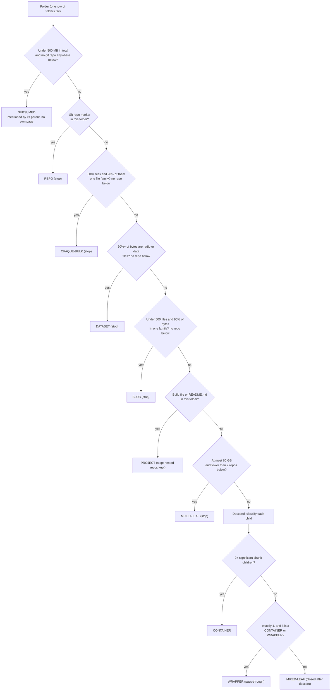
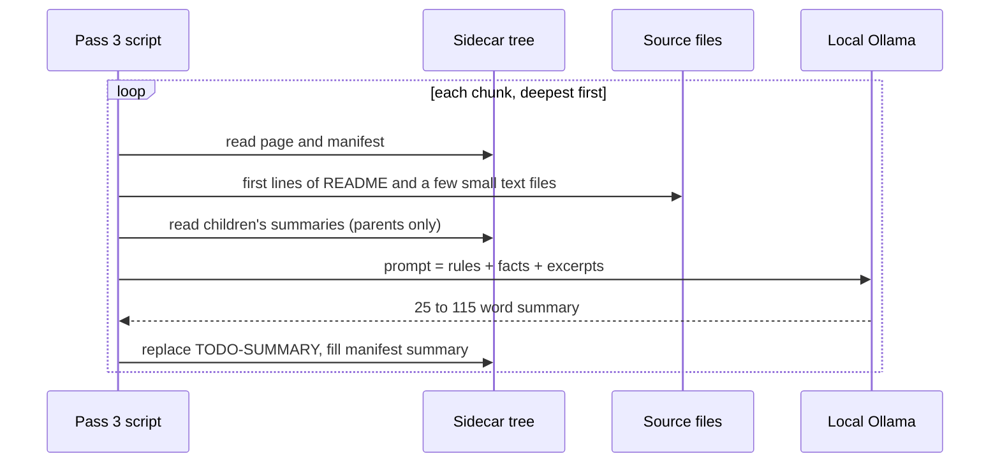
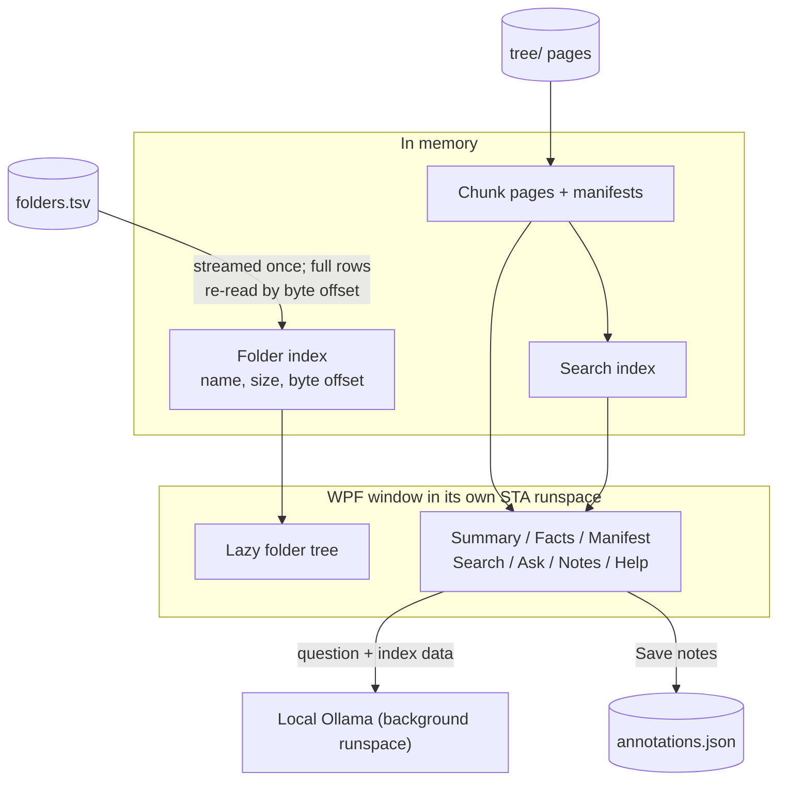

# llms-tree

**Turn a terabyte of unlabelled storage into a navigable tree of small, LLM-friendly index files. Read-only, deterministic, and built entirely from the tools already on a Windows machine (PowerShell 5.1).**

`llms-tree` walks a large, heterogeneous file share, decides *where the meaningful boundaries are* (repositories, projects, datasets, piles of media), writes a small [`llms.txt`-style](#references) index page for each boundary, and optionally asks a local language model to write a short summary of each one. The result is a tree of tiny, linked pages that a human or an AI agent can read from the top and drill down, instead of facing a million-file directory listing.

> [!IMPORTANT]
> **Your data is never modified.** Every script is read-only with respect to the folder being scanned. All output goes to a separate *sidecar* run folder. See [Safety guarantees](#safety-guarantees).

## At a glance

| You have | You get |
|---|---|
| A network share or drive with repos, media, research data, backups, build output, ... and no map | A tree of short `llms-txt.md` pages (one per meaningful chunk), each with facts, links to children and, optionally, a 25 to 115 word summary |
| Millions of files that no one can read | A bounded index: **never more than 53 links per page**, so every page fits in an LLM context window |
| A need to *search and explore* the result | A native Windows explorer (tree, rendered pages, search, chat with a local model) and a graph export |



### The idea in one paragraph

A flat list of a million files is useless to a person and too big for a model. But storage is *structured*: a folder with a `.git` directory is one repository; a folder of 800 numbered PNGs is one art collection; a folder with six 4 GB `.sigmf-data` files is one radio dataset. `llms-tree` measures each folder's cheap signals (names, sizes, dates, extension mix, marker files) once, bottom-up; applies explicit, tunable rules top-down to decide where to **stop descending and call something a chunk**; and writes one small page per chunk. Parents summarise their children, so the tree is an *index of indexes*. Files are described in aggregate ("840 images, 4.7 GB") rather than listed, and a language model is only used at the very end, on a bounded amount of text, to describe what is already known.



## Files at a glance

All scripts are plain-text **paste blocks**: each is wrapped in `& { ... }`, carries its settings as variables at the top, and is run by pasting it into a PowerShell 5.1 console. No `.ps1` file is ever executed, so script execution policy does not apply.

| Script | Role | Reads | Writes | Needs |
|---|---|---|---|---|
| [`pass0-inventory.txt`](#pass-0-inventory) | Crawl the source tree; one row per folder | Source tree (names, sizes, dates) | `folders.tsv`, `skipped.tsv`, `errors.tsv`, `extensions.tsv`, `run.json` | Nothing else |
| [`pass1-classify.txt`](#pass-1-classify) | Decide which folders become chunks | `folders.tsv` | `classification.tsv`, `classification-summary.txt` | Nothing else |
| [`pass2-emit.txt`](#pass-2-emit) | Write the page tree | `folders.tsv`, `classification.tsv` | `tree/**/llms-txt.md`, `llms-manifest.json`, `pass2-index.tsv` | Nothing else |
| [`pass3-summarize.txt`](#pass-3-summarize) | Fill in summaries with a local model | The `tree/`, plus a few README/text heads from the source | Same pages (summary line), `pass3-log.tsv` | Local [Ollama](https://ollama.com) |
| [`post01-mega-manifest.txt`](#post-01-mega-manifest) | Roll everything into one graph + catalogue | `tree/` | `mega-manifest.json` (+`.jsonl`), `nodes.csv`, `edges.csv`, `mega-catalog.md` | Nothing else |
| [`post02-explorer.txt`](#post-02-explorer) | Interactive window: browse, search, ask | The run folder only | `annotations.json` (your notes only) | Windows (WPF); Ollama for the Ask tab |

## Quick start

1. **Pass 0.** Open PowerShell 5.1, `cd` into the folder you want to map, set `$OutRoot` (anywhere *outside* that folder), paste `pass0-inventory.txt`. Note the `Sidecar:` path it prints.
2. **Pass 1.** Set `$RunDir` to that sidecar path, paste `pass1-classify.txt`. Read the summary; adjust `MaxLeafBytes` if you want finer or coarser chunks, and paste again (it reads only the manifest, so re-running is cheap).
3. **Pass 2.** Set `$RunDir`, paste `pass2-emit.txt` (it defaults to a **dry run** that prints previews). Set `$DryRun = $false` and paste again to write the tree.
4. **Pass 3 (optional).** With Ollama running, set `$RunDir`, paste `pass3-summarize.txt` (dry run first, then `$Limit = 3` for a trial, then everything).
5. **Browse.** Set `$Cfg.RunDir` in `post02-explorer.txt` and paste it. Or run `post01-mega-manifest.txt` for the graph and catalogue files.

What you will see after step 3, on the fictional example share used throughout this document:

```text
Loaded 28 folders, 13 chunks.
llms-tree Pass 2 WRITE   chunks=13  emitted=13  collapsed wrappers=0  group files=0
files to write: 13 llms-txt.md (incl. groups) + 13 llms-manifest.json
max links in one file: 6  (cap 53)
validation problems: 0
Wrote sidecar tree: C:\Users\you\llms-out\20261101-174700\tree
```

### Safety guarantees

| Guarantee | How it is kept |
|---|---|
| The scanned folder is never written to | No script opens a source file for writing; the sidecar location is refused if it is inside the scanned root |
| File *contents* are not read in Passes 0 to 2 | Pass 0 uses directory listings only (names, sizes, dates, attributes). Optional header sniffing is **off** by default and reads at most 512 bytes of a few extension-less files |
| Only Pass 3 reads content | It reads the first lines of README-class and a few small text files per chunk, and sends them to **your local** model only |
| Nothing is deleted from your data | Passes only ever delete their own sidecar `tree/` folder (Pass 2, `$CleanTree`) |
| Re-runs are safe | Each Pass 0 run gets a new time-stamped folder; later passes overwrite their own outputs |

## Extension-family inventory

Pass 1 and Pass 2 use the same curated extension map. It covers common raster/vector images, video and audio, office and publishing documents, compressed/container formats, SDR and scientific/tabular data, source languages, configuration and web assets, databases, 2D/3D design and CAD, GIS, ML models, binaries/packages, subtitles/playlists, email/calendar/contact files, localization, logs, and network captures. This is a practical inventory, not an exhaustive registry of every format.

Family names are exclusive: each listed suffix maps to one family. Ambiguous generic suffixes such as `.bin` and `.dat` are deliberately not assigned because extensions alone cannot identify their contents. `data` remains limited to recognized scientific/tabular dataset formats (and the existing `.sqlite`/`.sqlite3` mapping); `database` is separate and does not contribute to R-140's `DatasetShare`. New `data` entries do contribute, so R-140 remains a suffix-based heuristic rather than content detection.

## 3. Result on your manifest (MaxLeafBytes 20 GB, SigShare 0.10)

## Table of contents

- [At a glance](#at-a-glance)
  - [The idea in one paragraph](#the-idea-in-one-paragraph)
- [Files at a glance](#files-at-a-glance)
- [Quick start](#quick-start)
  - [Safety guarantees](#safety-guarantees)
- [Prerequisites](#prerequisites)
  - [Environment](#environment)
  - [Running a paste block](#running-a-paste-block)
  - [Settings convention](#settings-convention)
  - [Setting up Ollama (Pass 3 and the Ask tab)](#setting-up-ollama-pass-3-and-the-ask-tab)
  - [Repository layout](#repository-layout)
- [Design and approach](#design-and-approach)
  - [The problem](#the-problem)
  - [Design principles](#design-principles)
  - [Bottom-up aggregation: post-order depth-first search](#bottom-up-aggregation-post-order-depth-first-search)
  - [Top-down stop rules: where the chunks are](#top-down-stop-rules-where-the-chunks-are)
  - [Semantic heuristics: cheap signals, explicit thresholds](#semantic-heuristics-cheap-signals-explicit-thresholds)
  - [Chunking, granularity and the fan-out cap](#chunking-granularity-and-the-fan-out-cap)
  - [Change detection with Merkle fingerprints](#change-detection-with-merkle-fingerprints)
  - [Where the language model sits](#where-the-language-model-sits)
  - [Comparison with alternatives](#comparison-with-alternatives)
  - [Trade-offs and failure modes](#trade-offs-and-failure-modes)
- [The passes](#the-passes)
  - [The example share](#the-example-share)
- [Pass 0: Inventory](#pass-0-inventory)
  - [Pass 0: how it works](#pass-0-how-it-works)
  - [Pass 0: example session](#pass-0-example-session)
  - [Pass 0: what it writes](#pass-0-what-it-writes)
  - [Customizing Pass 0](#customizing-pass-0)
- [Pass 1: Classify](#pass-1-classify)
  - [Pass 1: how it works](#pass-1-how-it-works)
  - [Pass 1: example session](#pass-1-example-session)
  - [Customizing Pass 1](#customizing-pass-1)
- [Pass 2: Emit](#pass-2-emit)
  - [Pass 2: how it works](#pass-2-how-it-works)
  - [Pass 2: example session](#pass-2-example-session)
  - [Pass 2: what it writes](#pass-2-what-it-writes)
  - [Pass 2: anatomy of a page](#pass-2-anatomy-of-a-page)
  - [Customizing Pass 2](#customizing-pass-2)
- [Pass 3: Summarize](#pass-3-summarize)
  - [Pass 3: how it works](#pass-3-how-it-works)
  - [Pass 3: example session](#pass-3-example-session)
  - [Pass 3: privacy and trust](#pass-3-privacy-and-trust)
  - [Customizing Pass 3](#customizing-pass-3)
- [The post scripts](#the-post-scripts)
- [Post 01: Mega manifest](#post-01-mega-manifest)
  - [Post 01: how it works](#post-01-how-it-works)
  - [Post 01: example session](#post-01-example-session)
  - [Customizing Post 01](#customizing-post-01)
- [Post 02: Explorer](#post-02-explorer)
  - [Using it](#using-it)
  - [Search](#search)
  - [Ask Ollama](#ask-ollama)
  - [Notes](#notes)
  - [How it is built](#how-it-is-built)
  - [Customizing Post 02](#customizing-post-02)
- [Customization recipes](#customization-recipes)
  - [Finer or coarser chunks](#finer-or-coarser-chunks)
  - [Keep small siblings visible next to a huge dataset](#keep-small-siblings-visible-next-to-a-huge-dataset)
  - [A studio on Unreal Engine or Unity](#a-studio-on-unreal-engine-or-unity)
  - [A photo or video archive](#a-photo-or-video-archive)
  - [Many repositories](#many-repositories)
  - [Pages named llms.txt](#pages-named-llmstxt)
  - [A different model, or less text sent to it](#a-different-model-or-less-text-sent-to-it)
- [Roadmap](#roadmap)
  - [Known limitations](#known-limitations)
- [Glossary](#glossary)
- [FAQ](#faq)
- [Troubleshooting](#troubleshooting)
- [Versions and changelog](#versions-and-changelog)
- [References](#references)


## Prerequisites

### Environment

| Requirement | Needed for | How to check |
|---|---|---|
| **Windows PowerShell 5.1** (the default on Windows 10 and 11) | All scripts | `$PSVersionTable.PSVersion` shows `5.1.x` |
| **.NET Framework** (ships with Windows) | All scripts (file system, hashing, JSON) | Nothing to install |
| **WPF** (Windows desktop component of .NET Framework) | Post 02 only | Present on Windows client; **not** on Server Core |
| **Read access** to the share you want to map | Pass 0 | Listing the folder in Explorer is enough |
| **Write access** to a *separate* output folder | Pass 0 (`$OutRoot`) | Anywhere outside the scanned tree; defaults to `%USERPROFILE%\llms-out` |
| **[Ollama](https://ollama.com)** with a pulled model | Pass 3 and the explorer's Ask tab | `ollama list`; the default settings use `gemma4:latest` on `http://localhost:11434` |

Only default Windows tooling is used: no modules, no installs, no package managers. The data layers also run under PowerShell 7, which is how the logic was regression-tested, but the target is Windows PowerShell 5.1 and the explorer needs WPF.

### Running a paste block

Every script is a text file whose entire content is one `& { ... }` expression. To run one:

1. Open **Windows PowerShell** (the blue console, version 5.1; not PowerShell 7).
2. For Pass 0, `cd` to the folder you want to map. Other scripts do not care about the current folder.
3. Open the `.txt` file, edit the variables in the block marked `VARIABLES (edit me)` at the top, select all, copy.
4. Paste into the console and press Enter if the console is still waiting.

If your terminal mangles large pastes (smart quotes, truncated lines), run the file from disk instead. This still never executes a `.ps1`:

```powershell
Get-Content -Raw .\pass1-classify.txt | Invoke-Expression
```

> [!TIP]
> Each script is written as a single expression so that a paste either runs completely or not at all. Nothing runs until the closing `}` has arrived.

**About the explorer and threads.** WPF windows need a single-threaded apartment (STA); the Windows PowerShell console is multi-threaded by default. `post02-explorer.txt` detects this and starts its own STA runspace automatically. Nothing for you to do.

### Settings convention

Every script follows the same pattern:

```powershell
# =====================================================================  VARIABLES (edit me)
$RunDir  = 'D:\llms-out\REPLACE-WITH-STAMP'
$DryRun  = $true          # scripts that write default to a dry run
...
# =====================================================================  END VARIABLES
```

* **`$RunDir`** is the sidecar folder that Pass 0 created (`<OutRoot>\<yyyyMMdd-HHmmss>`). Every later script is pointed at it.
* **`$DryRun`** (Pass 2, Pass 3) defaults to `$true`: the script prints what it *would* do and writes nothing.
* Anything that looks like a threshold, name, or list is a variable. The **Customizing** subsection of each pass tabulates them.

### Setting up Ollama (Pass 3 and the Ask tab)

```powershell
ollama pull gemma4:latest                   # or any model you prefer
Invoke-RestMethod http://localhost:11434/api/tags | Select-Object -ExpandProperty models | Select-Object name
```

If the second command lists your model, the scripts' default settings will work. Pass 3 and the explorer both support two modes: `api` (HTTP request to the local Ollama service; recommended) and `cli` (pipes the prompt to `ollama run <model> --think=false`). The model name is a variable in each script.

### Repository layout

The scripts keep a `.txt` extension on purpose: they are meant to be pasted, not executed.

```text
llms-tree/
|-- README.md
`-- scripts/
    |-- pass0-inventory.txt         Pass 0
    |-- pass1-classify.txt          Pass 1
    |-- pass2-emit.txt              Pass 2
    |-- pass3-summarize.txt         Pass 3
    |-- post01-mega-manifest.txt    Post 01
    `-- post02-explorer.txt         Post 02
```

[Back to top](#table-of-contents)

---

## Design and approach

### The problem

The [llms.txt proposal](#references) gives websites a small, structured Markdown file (`# Title`, a `> summary` blockquote, then `## Sections` of links) that an agent reads first and then follows. Two properties make it work: **the file is small enough to fit in context**, and **the detail lives behind the links**.

A 1 TB research and engineering share breaks the obvious approach in three ways:

1. **Scale.** One file listing every path would be millions of lines. The spec's premise (small, curated) is violated at the first step.
2. **Heterogeneity.** The same share may hold a game engine repository, 800 concept-art images, radio-telescope style IQ recordings, MATLAB models and a folder of 2019 build zips. No single rule ("one page per folder", "one page per N files") describes all of those sensibly.
3. **Unknown contents.** Nothing is labelled. Reading everything to find out is exactly the cost we are trying to avoid.

`llms-tree` answers with **a tree of small pages whose boundaries are chosen by explicit heuristics over cheap metadata**, as the next sections explain.

### Design principles

| Principle | What it means in practice |
|---|---|
| **Read-only on your data** | The only writes are to a sidecar folder. Pass 0 refuses an output path inside the scanned tree |
| **Metadata first, content last** | Passes 0 to 2 use names, sizes, timestamps and extension counts. Content is read only in Pass 3, and only a few KB per chunk |
| **Deterministic until the last step** | The same manifest and settings always give the same chunks and pages. The language model fills in one line per page and nothing else |
| **Everything is a variable** | Thresholds, marker lists, extension families, name patterns and file names are settings at the top of each script |
| **Bounded output** | At most 53 links per page, a capped number of tree rows, a capped evidence size per summary |
| **Resumable and re-runnable** | A crashed crawl restarts from finished folders; every later pass is idempotent |
| **Inspectable** | Every chunk records the rule that created it and why (`classification.tsv`, `Why:` lines) |

### Bottom-up aggregation: post-order depth-first search

Pass 0 visits the tree with a **post-order depth-first traversal** (DFS)[^cormen]. In a post-order traversal a folder is processed *after* all of its children. That is exactly what you need to compute a **subtree aggregate**, such as "how many bytes are below here?", in a single pass: the answer for a folder is its own files plus the answers its children have already finished computing.



The crawl, in pseudocode:

```text
Crawl(folder):
    for each entry in ONE directory listing of folder:
        if file:    add size/date to counters; count its extension; test its name against marker lists;
                    add "name|size|mtime" to this folder's signature list
        if folder:  skip it (symlink, excluded name, hidden, depth limit) and record why,
                    or remember it as a child to visit
    for each remembered child:
        stats = Crawl(child)                # recursion; on resume, reuse the child's finished row instead
        merge stats into this folder's subtree totals
    emit ONE row for folder                 # post-order: written only when the whole subtree is done
    return subtree totals
```

Two consequences matter operationally:

* **Cost.** One directory listing per folder, no file is opened (with sniffing off). Time is proportional to the number of directory entries and dominated by the storage latency, not by CPU. Memory holds only the aggregates along the current path (plus, on resume, one line per already-finished folder).
* **Resumability.** A row is written only when a folder's whole subtree is finished. If the run is interrupted, every row on disk is *complete*. On resume, those folders are loaded and skipped; only the unfinished branches are crawled again.

The other passes use the same idea differently. **Pass 1** works *top-down* (a pre-order walk) because the decision to *stop descending* must be made before looking at the children, then adds a bottom-up count to decide whether a folder is really a container. **Pass 3** processes chunks *deepest first* so that a parent's summary can be written from its children's already-written summaries.

### Top-down stop rules: where the chunks are

A **chunk** is a folder that gets its own page. The classifier walks from the root; at each folder it asks a fixed sequence of questions. The first that fires decides the folder's type. Some types are **stop types**: the folder becomes one chunk and the walk does not descend, because its internal structure is not worth indexing separately.



The thresholds in the diagram (500 MB, 90%, 60%, 500 files, 60 GB) are the shipped defaults and all are [variables](#customizing-pass-1). The root folder is special: it is never a `PROJECT` or a closed leaf, so it always becomes a container (it must be an entry point).

### Semantic heuristics: cheap signals, explicit thresholds

"Semantic" here does not mean machine understanding; it means *encoding what folders usually mean* as explicit tests on cheap measurements. Each heuristic is a hypothesis you can read, tune and override.

| Signal | Measured in | Hypothesis it supports | Used by |
|---|---|---|---|
| **Marker names** (`.git`, `pyproject.toml`, `*.sln`, `README.md`, `*.sigmf-meta`, ...) | Pass 0, from names only | "A `.git` entry means a repository"; "a build file means a project" | REPO, PROJECT, DATASET |
| **Extension mix** (counts and bytes per extension, grouped into *families*: image, video, archive, sdr, ...) | Pass 0 | "800 `.png` files are an art collection, not 800 things" | OPAQUE-BULK, BLOB, DATASET |
| **Size floor** | Pass 1 | "A folder under 500 MB is not worth its own page" (except repos, or anything containing one) | SUBSUMED |
| **Significance share** | Pass 1 | "A child holding under 10% of its parent's bytes does not make the parent a container" | CONTAINER, WRAPPER |
| **Leaf size ceiling** | Pass 1 | "A mixed folder under 60 GB is one thing; above that, look inside" | MIXED-LEAF |
| **Name crumbs** (`old`, `backup_2019`, `tmp`, `archive`, year-like names) | Pass 0 | "Names like these usually mean cold or disposable material" | `cold` flag |
| **Age** (newest file older than 5 years) | Pass 0 dates, Pass 1 | "Nothing has changed here in years" | `cold-age` flag |

Two design choices deserve a note.

**Counts for bulk, bytes for blobs.** A pile of 800 PNGs is recognised by *file count and dominance of one family* (OPAQUE-BULK): the interesting fact is that there are many similar files. Three 18 GB videos are recognised by *byte dominance when there are few files* (BLOB): the interesting fact is that a few huge files make up the whole folder. Using counts for the second would call everything with three files "mixed".

**Strong versus weak markers.** The first real test was a game library, where file extensions mean something different from engineering folders: `.mat` is a *material*, not a MATLAB data file; `.db` is a thumbnail cache; 211 folders contained an extension-less `README`. A marker that is cheap to detect is not necessarily meaningful. So Pass 1 trusts only `Build` markers in the folder itself, strictly named READMEs (`readme.md`, `readme.txt`, ...), and radio markers in combination with a data-byte share. Weak markers are still *recorded* in the manifest; they are simply not acted on. Tuning a marker's trust needs no re-crawl.

### Chunking, granularity and the fan-out cap

The single most important knob is `MaxLeafBytes`: how large a non-stop folder may be before the classifier looks inside it. On the real 518 GB game library (15,400 folders, 228,901 files) the chunk count responded like this:

| `MaxLeafBytes` | Chunks | What changes |
|---|---:|---|
| 5 GB | 123 | Most large games split into sub-chunks |
| 10 GB | 96 | |
| 20 GB | 64 | Mostly one chunk per game; the biggest installs still split |
| 40 GB | 52 | |
| 60 GB (default) | 36 | One chunk per game, plus a few wrappers and containers |
| 100 GB | 36 | No further change |

Three mechanisms keep the tree usable at any setting:

* **Wrapper collapse.** A folder whose only significant content is one child (`Game\GameData\Vanilla`) is a pass-through. In Pass 2 it is not emitted; its parent links straight to the child.
* **The 53-link cap.** No page holds more than **53** links (the first prime above 50; any bound that fits comfortably in a model's context would do). A chunk with more children than will fit is split into **virtual group pages** (`_g01`, `_g02`, ...) in the sidecar, which link to the real children; the groups recurse until every page is under the cap.
* **Subsumption.** Small folders are not lost: the parent's page lists the larger ones and states how many smaller ones, and how many bytes, were left out.

### Change detection with Merkle fingerprints

On a live share you need to know *what changed since last time* without reading terabytes. Pass 0 computes two short hashes per folder, a small instance of a Merkle tree[^merkle]:

```text
DirSig  = H( sorted list of this folder's entries:  "f|name|size|mtime"  for files,  "d|name"  for folders )
TreeSig = H( DirSig + sorted list of  "childName:childTreeSig" )
```

Any add, delete, rename, resize or touch below a folder changes its `TreeSig` and that of every ancestor, but not its siblings'. Comparing two runs' `folders.tsv` by `RelPath` and `TreeSig` tells you exactly which branches changed. The root's `TreeSig` is stored in `run.json` as a one-value fingerprint of the entire run. (The shipped passes *record* the signatures; automatic reuse of unchanged pages is on the [roadmap](#roadmap).)

> [!NOTE]
> The fingerprint covers names, sizes and timestamps, not contents. An edit that preserves size and timestamp is invisible to it. Directory timestamps are deliberately excluded because they are noisy on network shares.

### Where the language model sits

The model is the *last* and *least trusted* stage:

* Everything factual on a page (sizes, counts, dates, type, links) is written **deterministically** in Pass 2. The model supplies only the one-paragraph `> summary` line.
* The model sees a **bounded evidence pack**: the facts, the first lines of a README or two, short excerpts of a few small text files, a sample of file and folder names, and (for parents) the children's summaries. Not the data.
* It is told to use only that evidence and to say "appears to" when unsure. Output is cleaned and forced into 25 to 115 words.
* Chunks are processed **deepest first**, so a parent is summarised from its children's summaries, not from raw files: a hierarchical summarisation that keeps every prompt small.

Treat summaries as *navigation hints*, not as ground truth.

### Comparison with alternatives

| Alternative | Strength | Why it is not enough here |
|---|---|---|
| `sitemap.xml`[^sitemaps] style flat list | Complete, standard, machine-readable | Millions of lines; no curation or summaries; no external context; far larger than a context window |
| `/.well-known/` location (RFC 8615)[^rfc8615] | Standard place for metadata | Only exists at an origin root; a file share has no such place, and per-folder indexes are the point |
| One huge `llms.txt` | Simple | Violates the "small enough to fit in context" premise of the format |
| Embed every file into a vector store | Powerful semantic search | Needs reading all content (TBs), embedding infrastructure and a retrieval service; this tool needs only directory listings plus one small model call per chunk |
| OS search (Windows Search, Everything, `find`) | Fast filename search | Answers "where is X?", not "what is this share?" and is unusable by an agent with a small context |

### Trade-offs and failure modes

| Behaviour | Why | What you can do |
|---|---|---|
| **A byte-dominant parent absorbs small siblings.** In the example share, `Research` (99.99% radio and data bytes) becomes one `DATASET` chunk even though it also contains a small MATLAB project | Stop rules fire at the highest qualifying folder | The page still lists both subfolders. Lower the share thresholds, or [override with a recipe](#customization-recipes) |
| **Heuristics follow extensions, not content.** A `.dat` that is a text log counts as data | Cheap by design | Edit the extension families and marker lists |
| **Hidden folders and excluded names (`bin`, `obj`, `node_modules`, ...) are not entered**, so their bytes are not counted | Avoid noise and scale problems | Edit `ExcludeDirNames`; read `skipped.tsv` to see what was skipped |
| **Fingerprint ignores content** | Reading files would defeat the purpose | See [Merkle fingerprints](#change-detection-with-merkle-fingerprints) |
| **Summaries can be wrong** | Small model, little evidence | Read the evidence in the dry run; adjust the prompt limits; review in the explorer |
| **No global file-name index** | A run records folders, not individual files | See the [roadmap](#roadmap) |

[Back to top](#table-of-contents)

---


## The passes

Four passes build the index. Each reads the previous pass's output from the run folder, so any pass can be re-run (with different settings) without repeating the earlier ones.

| Pass | Question it answers | Output | Reads content? |
|---|---|---|---|
| [0 Inventory](#pass-0-inventory) | What is here, how big, how old, what markers? | `folders.tsv` | No |
| [1 Classify](#pass-1-classify) | Which folders deserve their own page, and of what kind? | `classification.tsv` | No |
| [2 Emit](#pass-2-emit) | What does each page say, and how do pages link? | `tree/**/llms-txt.md` | No |
| [3 Summarize](#pass-3-summarize) | What is each chunk, in a few sentences? | summary lines | A few KB per chunk |

### The example share

The fictional **Brightmoor Studio** share used for every example below (28 folders, 915 files, 96.3 GB; most files are sparse placeholders, so only sizes and names matter):

```text
BrightmoorShare\
|-- Projects\
|   |-- Starfall\            git repo, Visual Studio solution, README, 6 GB of packaged game content
|   |-- Engine\              git repo, CMake build, 700 MB SDK bundle
|   `-- Starfall-Tools\      small git repo (Python)
|-- Tools\                   three tiny git repos (localization, telemetry, build farm)
|-- Art\
|   |-- ConceptArt\          800 PNG frames
|   `-- Source\              40 PSD files
|-- Capture\Playtests\       three 15-22 GB MKV recordings
|-- Research\
|   |-- WirelessController\  six 4 GB SigMF IQ recordings + metadata + README
|   `-- Models\              MATLAB .m files, a Simulink model, a 900 MB results .mat, README
|-- Archive\old_builds_2019\ eight 700 MB ZIP files (dated 2019)
`-- Admin\                   two tiny text files
```

[Back to top](#table-of-contents)

---

## Pass 0: Inventory

**Purpose.** Produce a flat, resumable *manifest*: one row per folder, containing everything later passes need. This is the only pass that touches the source tree, and it only lists it.

### Pass 0: how it works

1. **Resolve and guard.** Resolve `$Root` (default: the current folder), create the time-stamped run folder under `$OutRoot`, and **refuse to run if `$OutRoot` is inside `$Root`** (the sidecar must never appear in what it describes).
2. **Walk post-order** (see [the design](#bottom-up-aggregation-post-order-depth-first-search)). For each folder, one directory listing (via `DirectoryInfo.EnumerateFileSystemInfos`) gives every entry's name, attributes, size and last-write time. Long and UNC paths use the `\\?\` prefix, so the 260-character limit does not apply.
3. **Per file:** add to the folder's counts, bytes, oldest/newest date and extension histogram; test the name against the marker tables (exact names, extensions, a `readme` prefix); append `name|size|mtime` to the signature list; optionally sniff 512 bytes of a few extension-less files.
4. **Per sub-folder:** decide *visit or skip*:
   * **Symlinks and junctions** (reparse points) are never followed; recorded in `skipped.tsv` as `reparse`.
   * **Excluded names** (`.git`, `node_modules`, `bin`, `obj`, `__pycache__`, `$RECYCLE.BIN`, ...) are recorded as `excluded`. A marker match (such as `.git`) is recorded *before* the exclusion is applied, so a repository is still detected even though its internals are not entered.
   * **Hidden folders** are recorded as `hidden` and not entered (hidden *files* are counted).
   * Past `$MaxDepth` (if set) they are recorded as `maxdepth`.
5. **Merge and emit.** After visiting the children, merge their totals, compute `DirSig`/`TreeSig`, evaluate name crumbs, and append one row to `folders.tsv`.
6. **Heartbeat and flush.** Every 20 seconds it prints folders and files seen, gigabytes so far, files per second and the current folder; rows are flushed to disk in batches.

### Pass 0: example session

```text
PS D:\> cd D:\BrightmoorShare
PS D:\BrightmoorShare> # ...paste pass0-inventory.txt, variables left at their defaults...
Done. folders=28 files=915 size=96.3 GB RootTreeSig=B6553986A5521C94
Sidecar: C:\Users\you\llms-out\20261101-174700
```

On a long crawl the heartbeat lines appear in between. If the run is interrupted, set `$RunDir` to the printed sidecar path and paste again: finished folders are reused.

### Pass 0: what it writes

```text
20261101-174700\
|-- run.json          settings, host, start/finish, totals, RootTreeSig
|-- config.json       the effective $Config (so a run is self-describing)
|-- folders.tsv       the manifest: ONE ROW PER FOLDER
|-- extensions.tsv    global extension totals (files, bytes)
|-- skipped.tsv       every folder not entered, with the reason
`-- errors.tsv        access denied, enumeration failures, llms-name collisions
```

<details>
<summary><b>The 24 columns of <code>folders.tsv</code></b></summary>

`Sub*` columns cover **the whole subtree including the folder itself**; `Direct*` columns cover only its own entries.

| Column | Meaning |
|---|---|
| `RelPath`, `Depth` | Path relative to the root (`.` is the root) and depth (root = 0) |
| `DirectFiles`, `DirectBytes`, `DirectDirs` | The folder's own files, their bytes, and number of immediate sub-folders (including skipped ones) |
| `SubFiles`, `SubBytes`, `SubDirs` | Totals over the scanned subtree (`SubDirs` excludes the folder itself) |
| `MinWrite`, `MaxWrite` | Oldest and newest file date in the subtree (`yyyy-MM-dd`, UTC) |
| `DirectExt`, `SubExt` | Extension histograms as `ext:files:bytes;...`, top 30 by bytes plus `(other)` |
| `Markers`, `SubMarkers` | Breadcrumb counts as `Category=n;...` for the folder itself and for the subtree |
| `Readmes` | Up to three README-style file names in the folder |
| `NameCrumbs` | Matching folder-name tags (for example `Archive\|HasYear`) |
| `HiddenDirs`, `HiddenFiles`, `ExcludedDirs`, `ReparseSkipped` | What was skipped or hidden here |
| `Sniffed` | Header-sniffing results (`text=2;zip=1`) when enabled |
| `DirSig`, `TreeSig` | The [fingerprints](#change-detection-with-merkle-fingerprints) |
| `Errors` | Errors encountered in this folder |

</details>

A few real rows from the example run (selected columns):

| RelPath | Depth | SubFiles | SubBytes | Markers | Readmes | NameCrumbs | TreeSig |
|---|--:|--:|--:|---|---|---|---|
| `Projects\Starfall` | 2 | 17 | 5,997,854,983 | `Build=1;Readme=1;Repo=1` | `README.md` | | `90EAAB73C89BA939` |
| `Art\ConceptArt` | 2 | 800 | 3,355,443,200 | | | | `83734B589AB47661` |
| `Research\WirelessController\IQ` | 3 | 12 | 25,769,803,794 | `SDR=12` | | | `211F66ACF2E907CC` |
| `Archive\old_builds_2019` | 2 | 8 | 5,872,025,600 | | | `Archive\|HasYear` | `9B8DC448E68C5EFD` |

The `SubExt` of `Projects\Starfall` is `.pak:2:5368709120;.bk2:1:629145600;.cpp:6:126;.h:6:72;.md:1:61;.sln:1:4`, which is 90% `.pak` by bytes. That single string is the "semantic" evidence that this repository is mostly packaged game content. And `skipped.tsv` shows the repositories being detected but not entered:

```text
RelPath                 Name   Reason
Projects\Starfall-Tools .git   excluded
Projects\Starfall       .git   excluded
Projects\Engine         .git   excluded
Tools\LocalizationTool  .git   excluded
Tools\BuildFarm         .git   excluded
Tools\TelemetryDashboard .git  excluded
```

### Customizing Pass 0

Edit the variables at the top of `pass0-inventory.txt`.

| Variable | Default | Effect |
|---|---|---|
| `$Root` | `'.'` | Folder to scan. `'.'` means the current folder, so `cd` first |
| `$OutRoot` | `%USERPROFILE%\llms-out` | Parent of the run folders. Must be outside `$Root` |
| `$RunDir` | `''` | Set to an existing run folder to **resume** |
| `$ConfigPath` | `''` | Optional `.psd1` whose keys **replace** the matching `$Config` keys |
| `$SniffUnknown` | `$false` | Read the first 512 bytes of a few extension-less files per folder (`text`, `zip`, `png`, ...) |
| `$MaxDepth` | `0` | `0` = unlimited. `2` = quick look at the top two levels (a good first dry run) |
| `$Config.SkipHiddenDirs` | `$true` | Do not enter hidden folders |
| `$Config.FollowReparsePoints` | `$false` | Follow symlinks/junctions (not recommended: loops, double counting) |
| `$Config.ExcludeDirNames` | see script | Folder names never entered (still *detected* as markers) |
| `$Config.MarkerDirNames` / `MarkerFileNames` / `MarkerExts` | see script | Breadcrumb maps: name or extension to a **category** string |
| `$Config.ReadmePrefix` | `readme` | Files starting with this count as the `Readme` marker |
| `$Config.NameCrumbs` | see script | Regexes on a folder's *own name*, tagging `Archive`, `Temp`, `Misc`, `Year`, `HasYear`, `Version` |
| `$Config.ExtTopN` | `30` | Extensions kept per histogram column |
| `$Config.SniffMaxPerFolder` | `3` | Files sniffed per folder |
| `$Config.ProgressSeconds` | `20` | Heartbeat interval |
| `$Config.LlmsFileName`, `ManifestFileName` | `llms-txt.md`, `llms-manifest.json` | Output names (also used to detect collisions in your data; plain `llms.txt` is always flagged) |

**Example: a game studio on Unreal Engine.** Add the project-file extension as a `Build` marker and exclude generated folders. Because a key *replaces* the default rather than merging with it, copy the default lists and edit them. A config file is the tidiest way:

```powershell
# my-studio.psd1
@{
  ExcludeDirNames = @('node_modules','__pycache__','.git','.svn','.vs','Intermediate','Saved','DerivedDataCache','$RECYCLE.BIN','System Volume Information')
  MarkerExts      = @{ '.uproject'='Build'; '.sln'='Build'; '.csproj'='Build'; '.grc'='SDR'; '.sigmf-meta'='SDR'; '.cfile'='SDR'; '.slx'='Matlab' }
}
```

```powershell
$ConfigPath = 'C:\work\my-studio.psd1'    # in the variables block of pass0-inventory.txt
```

A new marker category matters only if a later pass is told to trust it. Pass 1 trusts `Build` by default, so `'.uproject'='Build'` takes effect immediately; a brand-new category such as `'GameEngine'` would also need adding to `$StrongMarkers` in Pass 1.

**Edge cases.** Access-denied folders are logged to `errors.tsv` and the crawl continues. A file named like your output (`llms-txt.md` or `llms.txt`) in the source is logged as `LLMS-NAME-COLLISION`. Very large folders (hundreds of thousands of entries) are fine: entries are streamed, not held. After a resume, finished folders carry their top-N histograms (counts and sizes stay exact; the rolled-up extension mix is approximate).

[Back to top](#table-of-contents)

---

## Pass 1: Classify

**Purpose.** From the manifest alone, decide *which folders become chunks* and *what kind of chunk* each is, recording the rule and reason. It reads only the manifest (no access to the source), so it is cheap and meant to be re-run while you tune.

### Pass 1: how it works

1. **Load** `folders.tsv` into an in-memory tree (each row linked to its parent).
2. **Walk top-down.** For each folder apply the [stop rules](#top-down-stop-rules-where-the-chunks-are) in this order:

   | Order | Rule | Condition (defaults) | Result |
   |---|---|---|---|
   | 1 | R-120 | Subtree under 500 MB *and* no repo anywhere below | `SUBSUMED` (no page) |
   | 2 | R-110 | A `Repo` marker in this folder | `REPO`, stop |
   | 3 | R-130 | 500+ files, 90% in one family, no repo below | `OPAQUE-BULK`, stop |
   | 4 | R-140 | 60% of bytes in `sdr`/`data` families (or an SDR marker here plus 30%), no repo below | `DATASET`, stop |
   | 5 | R-135 | Under 500 files, 90% of bytes in one family, no repo below | `BLOB`, stop |
   | 6 | R-150 | A `Build` marker or strict README in this folder (not the root) | `PROJECT`, stop (nested repos and big stop-types are kept as nested chunks) |
   | 7 | R-125 | At most 60 GB and fewer than 2 repos below (not the root) | `MIXED-LEAF`, stop |
   | 8 | R-160 | Otherwise **descend**; with 2+ significant chunk children (each at least 10% of the parent's bytes) | `CONTAINER` |
   |   | R-160 | exactly one significant child and it is a container or wrapper | `WRAPPER` |
   |   | R-170 | otherwise | `MIXED-LEAF` (descendant chunks discarded, but nested repos are kept) |

3. **Flag.** `cold` if the folder's own name matches `Archive` or `Temp` crumbs; `cold-age` if the newest file is older than 5 years.
4. **Report.** Write `classification.tsv` (sorted by path, root first) and `classification-summary.txt`: counts by type and depth, the largest chunks, and a fan-out check against the 53-link cap.

### Pass 1: example session

```text
PS D:\> # ...paste pass1-classify.txt with $RunDir = 'C:\Users\you\llms-out\20261101-174700'...
Loaded 28 folders.
llms-tree Pass 1 dry run   folders=28   chunks=13   (28 manifest rows)

--- chunks by type
REPO                   6          6.3 GB
CONTAINER              3        102.6 GB
BLOB                   2         60.5 GB
DATASET                1         24.9 GB
OPAQUE-BULK            1          4.7 GB

--- fan-out check (children chunks per parent chunk, limit 53)
ok: no parent exceeds the cap (direct children only; nested links not counted)

--- cold-flagged chunks: 1
```

`classification.tsv`, abridged:

| Rel | Type | Rule | GB | Files | Why |
|---|---|---|--:|--:|---|
| `.` | CONTAINER | R-160 | 96.3 | 915 | 2 significant chunk child(ren) |
| `Archive` | BLOB | R-135 | 5.47 | 8 | 100 % of bytes are archive in only 8 files |
| `Art` | OPAQUE-BULK | R-130 | 4.69 | 840 | 100 % of 840 files are image |
| `Capture` | BLOB | R-135 | 55 | 3 | 100 % of bytes are video in only 3 files |
| `Projects` | CONTAINER | R-160 | 6.27 | 35 | 2 significant chunk child(ren) |
| `Projects\Starfall` | REPO | R-110 | 5.59 | 17 | Repo marker in this folder |
| `Research` | DATASET | R-140 | 24.88 | 21 | sdr+data bytes 100 % |
| `Tools` | CONTAINER | R-160 | 0 | 6 | 3 significant chunk child(ren) |
| `Tools\BuildFarm` | REPO | R-110 | 0 | 2 | Repo marker in this folder |

Three things to notice. `Tools` totals about 125 *bytes* and is nevertheless a `CONTAINER`: **a folder that contains a repository is never subsumed**, so a folder of tiny repos still yields one chunk per repo. `Art` is *bulk* because of 800 files in one family, while `Capture` is a *blob* because of 3 files with all the bytes. And `Research` is one `DATASET`, absorbing its small MATLAB sibling (the [trade-off](#trade-offs-and-failure-modes) noted earlier).

### Customizing Pass 1

| Variable | Default | Effect |
|---|---|---|
| `$RunDir` | (set me) | The Pass 0 run folder |
| `$P.MinChunkBytes` | `500MB` | R-120. Below this a folder is subsumed (repos and folders containing repos are exempt) |
| `$P.MaxLeafBytes` | `60GB` | R-125. **The granularity dial.** Lower = more, finer chunks; higher = fewer, bigger ones |
| `$P.SigShare` | `0.10` | R-160. A child counts for container-ness only if it holds this share of the parent's bytes |
| `$P.NestedMinBytes` | `5GB` | R-155. Minimum size for a stop-type found *inside* a closed `PROJECT` (repos always kept) |
| `$P.BulkMinFiles` / `BulkShare` | `500` / `0.90` | R-130 |
| `$P.BlobShare` | `0.90` | R-135 |
| `$P.DatasetShare` / `DatasetMarkerShare` | `0.60` / `0.30` | R-140 |
| `$P.MaxEntries` | `53` | Used by the fan-out check |
| `$P.ColdAgeYears` | `5` | `cold-age` flag |
| `$StrongMarkers` | `@('Build')` | Marker categories (in the folder itself) that make a `PROJECT` |
| `$StrongReadmeNames` | `readme.md/.txt/.rst/.markdown` | README names that count (a bare `README` does not) |
| `$DatasetMarkers` | `@('SDR')` | Marker categories that make a `DATASET` likely |
| `$ExtFamilies` | image, video, audio, doc, archive, sdr, data, code | Which extensions belong to which family |

<details>
<summary><b>Example: finer or coarser chunks, and adding a family</b></summary>

```powershell
# Finer: split anything over 5 GB (the real 518 GB game library gives 123 chunks instead of 36)
$P = @{ ... MaxLeafBytes = 5GB ... }

# Count Unreal pak/utoc archives as archive-family, so a Content folder reads as BLOB/BULK
$ExtFamilies.archive += ' .utoc .ucas .upk'

# Treat a custom marker category as a project signal (see the Pass 0 example)
$StrongMarkers = @('Build','GameEngine')
```

Re-pasting Pass 1 is cheap and does not touch the earlier outputs, so tune until `classification-summary.txt` matches your expectation, *then* run Pass 2.

</details>

**Edge cases.** Hidden or excluded folders never reach Pass 1 (they are not in the manifest). The first design of the dataset rule applied an SDR marker anywhere in the subtree and classified a whole 96 GB share as one dataset; it now requires the marker in the folder itself plus a data-byte share, and any ancestor containing a repo is never a stop-type.

[Back to top](#table-of-contents)

---

## Pass 2: Emit

**Purpose.** Turn the classification into the page tree. Deterministic: same inputs and settings give byte-identical pages (apart from a footer date written by Pass 3).

### Pass 2: how it works

1. **Load** `folders.tsv` and `classification.tsv`; build the chunk tree (each chunk's parent is its nearest chunk ancestor).
2. **Collapse wrappers** (optional): a non-root `WRAPPER` with exactly one chunk child is not emitted; its parent links straight to that child.
3. **Budget the links.** For each emitted chunk, fill the page's 53 link slots in priority order:
   1. child chunks (cold ones go under `## Optional`),
   2. up to three README-style files,
   3. the largest non-chunk subfolders above 50 MB (archive/temp-looking ones go under `## Optional`).

   Whatever does not fit is *counted*, not silently dropped ("Not listed: 3 smaller subfolders totalling 29 MB, and 37 loose files").
4. **Group if needed.** If a chunk has more children than `MaxEntries - ReserveEntries` (47), split them alphabetically into virtual group pages `_g01`, `_g02`, ... that link to the real children; if there are too many groups, group the groups.
5. **Render** `llms-txt.md` and `llms-manifest.json` for each chunk. A `> TODO-SUMMARY` placeholder reserves the summary line.
6. **Validate** before writing: exactly one H1 and it comes first, no stray headings before the first `##`, link counts within the cap, valid structure. Problems are listed; none were found in the example.

Links are **relative and written as if the file lived in the source folder** (`Art/llms-txt.md`), so a later "publish" step could copy the pages in place and every link would work.

### Pass 2: example session

```text
PS D:\> # ...paste pass2-emit.txt with $RunDir set; $DryRun is $true by default...
Loaded 28 folders, 13 chunks.
llms-tree Pass 2 DRY RUN (nothing written)   chunks=13  emitted=13  collapsed wrappers=0  group files=0
files to write: 13 llms-txt.md (incl. groups) + 13 llms-manifest.json
max links in one file: 6  (cap 53)
validation problems: 0

=================== PREVIEW: . (CONTAINER) ===================
# BrightmoorShare
...
Dry run only. Set $DryRun = $false and paste again to write the sidecar tree.
```

### Pass 2: what it writes

```text
20261101-174700\
|-- pass2-index.tsv         one line per page: Rel, Type, File, Links, Bytes
|-- pass2-report.txt
`-- tree\
    |-- llms-txt.md                  the entry point (root)
    |-- llms-manifest.json
    |-- Art\llms-txt.md  ...
    |-- Projects\
    |   |-- llms-txt.md
    |   |-- Starfall\llms-txt.md, llms-manifest.json
    |   `-- Engine\ ...
    `-- _g01\llms-txt.md             only when a chunk has too many children
```

### Pass 2: anatomy of a page

This is the finished page for the `Starfall` repository (summary text is illustrative):

```markdown
# Starfall

> This repository holds Starfall, a C++ space-trading roguelike. It has gameplay source code, a Visual Studio solution and a README, plus a Content folder with two large game archives and an intro movie. It appears to be the main shipping project, with most of its size in packaged assets rather than code.

Path: Projects/Starfall. Type: REPO (R-110). 5.6 GB in 17 files; files last modified 2026-08-01 to 2026-08-01. Why: Repo marker in this folder.

Top file types by size: .pak 90 %, .bk2 10 %, .cpp 0 %, .h 0 %, .md 0 %.

Contents are not itemised file by file; use the sections below to navigate.

Not listed: 1 smaller subfolder(s) totalling 198 B, and 2 loose file(s) (65 B) directly in this folder.

## Key files
- [README.md](README.md): readme-style file

## Subfolders
- [Content](Content/): 5.6 GB, 3 files, .pak 90 %, .bk2 10 %

<!-- generated by llms-tree pass2 0.2; summary by gemma4:latest on 2026-11-01 -->
```

| Part | Source |
|---|---|
| `# Title`, `> summary` | Folder name; Pass 3 (or `TODO-SUMMARY` until then) |
| The facts paragraph, file-type shares, "Not listed" line | Pass 0 manifest; deterministic |
| `## Chunks`, `## Key files`, `## Subfolders`, `## Optional` | Chunk tree, README names, subfolder sizes |
| Trailing HTML comment | Provenance; kept *after* the H1 so the file still matches the llms.txt structure |

The **root page** is the entry point; its `## Chunks` list is the "table of contents" of the whole share:

```markdown
## Chunks
- [Art](Art/llms-txt.md): OPAQUE-BULK, 4.7 GB, 840 files
- [Capture](Capture/llms-txt.md): BLOB, 55.0 GB, 3 files
- [Projects](Projects/llms-txt.md): CONTAINER, 6.3 GB, 35 files
- [Research](Research/llms-txt.md): DATASET, 24.9 GB, 21 files
- [Tools](Tools/llms-txt.md): CONTAINER, 125 B, 6 files

## Optional
- [Archive](Archive/llms-txt.md): BLOB, 5.5 GB, 8 files, cold/cold-age
```

`Archive` sits under `## Optional` because it is flagged `cold`: an agent short on context can skip the section, which is the llms.txt convention for secondary links.

<details>
<summary><b><code>llms-manifest.json</code> (machine-readable twin of each page)</b></summary>

```json
{
  "id": "Projects/Starfall",
  "name": "Starfall",
  "type": "REPO",
  "rule": "R-110",
  "nested": false,
  "why": "Repo marker in this folder",
  "parent": "Projects",
  "children": [],
  "collapsedWrappers": [],
  "groups": [],
  "subfoldersListed": ["Content"],
  "stats": { "files": 17, "bytes": 5997854983, "directFiles": 2, "directBytes": 65,
             "minWrite": "2026-08-01", "maxWrite": "2026-08-01", "omittedSubfolders": 1, "omittedBytes": 198 },
  "extFamilies": { "archive": 0.895, "video": 0.105, "code": 0.0, "doc": 0.0, "other": 0.0 },
  "topExt": ".pak 90 %, .bk2 10 %, .cpp 0 %, .h 0 %, .md 0 %",
  "markers": { "Build": 1, "Readme": 1, "Repo": 1 },
  "subMarkers": { "Build": 1, "Readme": 1, "Repo": 1 },
  "readmes": ["README.md"],
  "crumbs": [],
  "flags": [],
  "treeSig": "90EAAB73C89BA939",
  "summary": "TODO",
  "generator": "llms-tree pass2 0.2",
  "links": 2
}
```

</details>

**When a chunk has too many children.** With the cap shrunk to 5 links (to demonstrate), the root's six children are listed through two group pages:

```markdown
# BrightmoorShare / _g01

> Virtual group of 3 entries from BrightmoorShare, in alphabetical order (Archive to Capture).

## Entries
- [Archive](../Archive/llms-txt.md): BLOB, 5.5 GB, 8 files, cold/cold-age
- [Art](../Art/llms-txt.md): OPAQUE-BULK, 4.7 GB, 840 files
- [Capture](../Capture/llms-txt.md): BLOB, 55.0 GB, 3 files
```

### Customizing Pass 2

| Variable | Default | Effect |
|---|---|---|
| `$RunDir` | (set me) | The run folder (needs `classification.tsv`) |
| `$DryRun` | `$true` | `$false` writes the tree |
| `$CleanTree` | `$true` | Delete the old `<RunDir>\tree` first, so renamed or stale files do not linger (sidecar only) |
| `$LlmsFileName` | `llms-txt.md` | Page name. Use `llms.txt` if the pages will be published as that |
| `$ManifestFileName` | `llms-manifest.json` | Manifest name |
| `$MaxEntries` | `53` | Hard link cap per page |
| `$ReserveEntries` | `6` | Slots kept free for README and subfolder links before grouping starts |
| `$ReadmeMax` | `3` | README links per page |
| `$ListMinBytes` | `50MB` | Smaller subfolders are counted, not listed |
| `$CollapseWrappers` | `$true` | Skip single-child pass-through pages |
| `$PreviewCount` | `3` | Pages printed in full during a dry run |
| `$ExtFamilies` | as Pass 1 | Used for the `extFamilies` shares in manifests |

**Examples.** Publish-ready names: `$LlmsFileName = 'llms.txt'` (and use the same value in Passes 3, Post 01 and Post 02). A longer cap for models with big context: `$MaxEntries = 97`.

**Edge cases.** Names with spaces, parentheses or apostrophes are URL-escaped in links (Windows PowerShell 5.1 leaves `( ) ' ! *` unescaped by default; these are escaped explicitly so Markdown links do not break). Links to README files and plain subfolders point at *source* paths, so they resolve only after the pages are copied into the source tree; links between pages resolve in the sidecar already.

[Back to top](#table-of-contents)

---

## Pass 3: Summarize

**Purpose.** Replace each `> TODO-SUMMARY` with a short, factual paragraph written by a **local** language model, using a small, bounded evidence pack per chunk.



### Pass 3: how it works

1. **Order.** List chunks from `pass2-index.tsv` and sort by depth, **deepest first**. Skip pages that no longer contain `> TODO-SUMMARY` (so it resumes automatically) unless `$Redo`.
2. **Evidence pack** per chunk, capped at 14,000 characters in total:

   | Part | Content |
   |---|---|
   | Facts | Name, path, *kind* in plain words, size, file count, dates, top file types, name hints |
   | README-class files | Up to 4 files (README, `package.json`, `pyproject.toml`, ...) at **80 lines / 4 KB** each; binary files are skipped |
   | Other text files | At most 2 more (code, config, docs) as **25-line / 1.5 KB** excerpts, so code does not drown the prompt |
   | Names | Up to 30 loose file names and 30 subfolder names, plus the largest subfolders from the manifest |
   | Children | For parents: each child chunk's summary, trimmed to 220 characters (up to 40 children) |

3. **Prompt.** A fixed instruction block (write 25 to 115 words; say what the folder is, what it contains and its apparent purpose; use only the evidence; say "appears to" when unsure; no markdown; excerpts may be incidental), then the evidence, then `SUMMARY:`.
4. **Call the model** (`api`: HTTP to the local Ollama service; `cli`: pipe to `ollama run`). Strip `<think>` blocks, markdown and prefixes such as "Summary:"; collapse whitespace; **cut at a sentence boundary** if over 115 words; retry once if empty or under 25.
5. **Write back.** Replace the blockquote in the page, update the footer ("summary by *model* on *date*"), set `"summary"` in the manifest, append a line to `pass3-log.tsv`.

### Pass 3: example session

First a dry run, which calls no model and prints the exact prompt for chunks so you can judge the evidence (excerpt):

```text
Source root: D:\BrightmoorShare
1 chunk(s) in scope; mode=api model=gemma4:latest dryRun=True

=================== PROMPT PREVIEW: Projects/Starfall (REPO, 1103 chars) ===================
You are writing one entry of an index that AI agents use to decide whether a folder is worth opening.
Write a plain-prose summary of 25 to 115 words that says what this folder is, ...

EVIDENCE
FACTS
Name: Starfall
Path: Projects/Starfall
Kind: git repository (version-controlled project)
Size: 5.6 GB in 17 files
File dates: 2026-08-01 to 2026-08-01
Top file types by size: .pak 90 %, .bk2 10 %, .cpp 0 %, .h 0 %, .md 0 %

FILE: README.md (first lines)
# Starfall - space trading roguelike (C++ / in-house engine)

FILES DIRECTLY IN THIS FOLDER: README.md, Starfall.sln

SUBFOLDER NAMES: Content, .git, Source

LARGER SUBFOLDERS: Content

SUMMARY:
```

Then a trial of three, then the full run (set `$DryRun = $false`; `$Limit = 3` for the trial):

```text
Ollama reachable; model present.
[hh:mm:ss] Projects/Engine  (40 words, x.xs)
[hh:mm:ss] Projects/Starfall  (52 words, x.xs)
[hh:mm:ss] Projects/Starfall-Tools  (28 words, x.xs)
Limit of 3 model calls reached.
Done: 3 written, 0 failed, 0 already had summaries, 3 model calls, hh:mm:ss. Log: ...\pass3-log.tsv
```

> [!NOTE]
> Elapsed times depend on the model, the hardware, whether the model is already loaded (the first call includes loading) and how much evidence a chunk has. The `x.xs` placeholders above are deliberate: this document makes no performance promise. `pass3-log.tsv` records the real numbers for your run.

The root page after Pass 3 (illustrative wording):

```markdown
# BrightmoorShare

> The root of a game studio's network share. It contains game and engine repositories, small internal tools, a large art collection, playtest videos, wireless-controller research data and old build archives. Playtest video and radio recordings account for most of the storage.
```

### Pass 3: privacy and trust

* The only content that leaves the source folder is the few KB of excerpts per chunk, and it goes to **the model endpoint you configure** (default `http://localhost:11434`). Point it elsewhere and it goes elsewhere.
* The model never receives the data itself, only the pack described above.
* Treat every summary as a hint. The deterministic facts on the same page are the reference.

### Customizing Pass 3

| Variable | Default | Effect |
|---|---|---|
| `$RunDir` | (set me) | Run folder (needs Pass 2 output) |
| `$DryRun` | `$true` | Print prompts only |
| `$Only` | `''` | One chunk id, e.g. `'Projects/Starfall'` (`'.'` is the root) |
| `$Limit` | `0` | Stop after N model calls (trial runs) |
| `$Redo` | `$false` | Regenerate chunks that already have a summary |
| `$SourceRoot` | `''` | Override the root recorded in `run.json` (if the drive letter or share path changed) |
| `$Mode` | `'api'` | `'api'` (REST) or `'cli'` (`ollama run`) |
| `$Model`, `$OllamaUrl` | `gemma4:latest`, `http://localhost:11434` | Which model, where |
| `$Think` | `$false` | Passed as `think` (api) or `--think=` (cli) |
| `$Temperature`, `$NumPredict`, `$KeepAlive`, `$TimeoutSec` | `0.2`, `400`, `30m`, `900` | Generation options |
| `$Retries` | `1` | Extra attempts if the answer is empty or too short |
| `$MinWords`, `$MaxWords` | `25`, `115` | Word window enforced on the result |
| `$HeadLines`, `$HeadMaxBytes` | `80`, `4096` | Excerpt size for README-class files |
| `$TextFilesMax`, `$OtherFilesMax` | `4`, `2` | Files read per chunk; how many of those may be non-README |
| `$OtherHeadLines`, `$OtherHeadMaxBytes` | `25`, `1500` | Excerpt size for other text files |
| `$FileNameSample`, `$DirNameSample`, `$EnumCap` | `30`, `30`, `3000` | Names shown; folder enumeration cap |
| `$EvidenceMaxChars`, `$ChildChars`, `$ChildMax` | `14000`, `220`, `40` | Prompt budget |
| `$TextExts`, `$PreferNames` | see script | Which files count as readable text; which are read first |
| `$TypeMeaning` | see script | Plain-language description per chunk type, shown to the model |

**Examples.** *Drier, shorter summaries:* `$MaxWords = 60`, `$Temperature = 0.1`. *A different model:* `$Model = 'qwen3:8b'` (any name that `ollama list` shows). *Less text leaves the folder:* `$TextFilesMax = 1`, `$HeadLines = 30`. *Use the command line instead of the API:* `$Mode = 'cli'`. *Redo one page after improving a README:* `$Only = 'Projects/Starfall'; $Redo = $true`.

**Edge cases.** The source may be unreachable (a detached drive): the evidence says so and the model works from facts alone. A model that returns an error or nothing leaves `TODO-SUMMARY` in place and is logged, so re-running only retries those. `think` support depends on your Ollama version; if it is rejected, set `$Think = $true` or use `cli` mode.

[Back to top](#table-of-contents)

---


## The post scripts

The passes build the index. The **post scripts** consume a finished run folder to make it usable by people and tools. Both are read-only with respect to the source and to the pages.

| Script | Turns the run folder into | Typical user |
|---|---|---|
| [Post 01: Mega manifest](#post-01-mega-manifest) | One connected **graph** (nodes and edges), a JSON-lines dump, CSV tables and a flat catalogue | Someone loading the structure into a graph editor, a database or a notebook |
| [Post 02: Explorer](#post-02-explorer) | An interactive **window**: lazy tree, rendered pages, search, notes, chat with a local model | Someone who wants to *look around* without opening files one at a time |

[Back to top](#table-of-contents)

---

## Post 01: Mega manifest

**Purpose.** Roll every per-chunk `llms-manifest.json` into single files, and make sure the result is a **connected tree**: every node has a parent, even where Pass 2 did not emit a page for the folders in between.

### Post 01: how it works

1. **Load** every `llms-manifest.json` under `tree\`. Node ids are the chunk's path with `/` separators; the root is renamed `llms-root`.
2. **Gap-fill.** For every id, walk its path prefixes. Any prefix that is not itself a chunk (a folder between a nested repository and its nearest chunk, or a wrapper that Pass 2 collapsed) gets a **synthetic node** (`type = folder`, `rule = gap-filler`, zero size, summary `(intermediate folder)`). Without this, a deeply nested repository would hang in the graph unattached.
3. **Style.** Each node's depth (number of path segments) picks a colour and radius from the tier tables (root cyan and largest, deeper levels progressively smaller).
4. **Link by path.** Each node gets exactly one edge to the node at its path parent. Because edges come from paths rather than from the manifests' `children` lists, the result is always a single tree.
5. **Write** five files into the run folder:

| File | Content |
|---|---|
| `mega-manifest.json` | The graph in the **LPG editor** format: `nodes[]` (id, label, x, y, colour, radius, `props`), `edges[]`, and view settings |
| `mega-manifest.jsonl` | One JSON object per node (type, rule, summary, files, bytes, flags, `treeSig`, `children`), for scripts and RAG pipelines |
| `nodes.csv`, `edges.csv` | Flat tables for spreadsheets, databases or graph imports |
| `mega-catalog.md` | A single readable Markdown list: one entry per node with type, size and summary |

### Post 01: example session

```text
PS D:\> # ...paste post01-mega-manifest.txt with $RunDir set...
Processed 13 nodes (including gap-fillers).
Success! Generated fully connected graph files in C:\Users\you\llms-out\20261101-174700:
  - mega-manifest.json (LPG Webapp Graph format)
  - mega-manifest.jsonl
  - nodes.csv & edges.csv
  - mega-catalog.md
```

(The example share needs no gap-fillers; a deeper tree such as a game library with a repository nested six folders down would add one synthetic node per missing level.)

An excerpt of the graph file (field names as written by the script; values from the example run):

```json
{
  "nodes": [
    { "id": "llms-root", "label": "BrightmoorShare", "x": 0.0, "y": 0.0, "color": "#00b4f0", "r": 50,
      "fontSize": 11, "labelAlign": "center", "labelColor": "",
      "props": { "type": "CONTAINER", "rule": "R-160", "summary": "The root of a game studio's network share...",
                 "bytes": 103406371526, "files": 915, "depth": 0, "isFiller": false } },
    { "id": "Projects/Starfall", "label": "Starfall", "x": 0.0, "y": 0.0, "color": "#c8f000", "r": 30,
      "fontSize": 11, "labelAlign": "center", "labelColor": "",
      "props": { "type": "REPO", "rule": "R-110", "summary": "This repository holds Starfall...",
                 "bytes": 5997854983, "files": 17, "depth": 2, "isFiller": false } }
  ],
  "edges": [
    { "id": "edge-1", "source": "Projects/Starfall", "target": "Projects", "label": "",
      "directed": true, "style": "straight", "dash": "solid", "arrowSize": "medium", "props": {} }
  ],
  "idCounter": 13, "graphId": "graph1", "graphMeta": { "edgedefault": "undirected" },
  "exportName": "llms-mega-manifest", "view": { "x": 0, "y": 0, "k": 1.0 }, "clampNodeLabels": false
}
```

Node positions are left at `(0, 0)`; the editor lays the graph out. Open the file in the LPG Webapp graph editor (the script prints its address; it is a third-party page hosted by its author, and the file is loaded locally in your browser).

### Customizing Post 01

| Variable | Default | Effect |
|---|---|---|
| `$RunDir` | (set me) | Run folder (needs `tree\`) |
| `$TreeSubdir` | `tree` | Name of the page-tree folder |
| `$ManifestFileName`, `$LlmsFileName` | `llms-manifest.json`, `llms-txt.md` | Must match Pass 2 |
| `$ExportName` | `llms-mega-manifest` | Stored in the graph file |
| `$GraphId` | `graph1` | Stored in the graph file |
| `$TierColors` | cyan, green, yellow-green, purple, coral | Colour by depth (index 0 = root; the last colour covers all deeper levels) |
| `$TierRadii` | `50, 40, 30, 25, 20` | Node radius by depth |

**Known quirk.** The root appears as `.` in `mega-manifest.jsonl` and `nodes.csv` but as `llms-root` in the graph and in `edges.csv`. Join on `llms-root` for the graph files and on `.` for the others, or map one to the other when loading (noted on the [roadmap](#roadmap)).

[Back to top](#table-of-contents)

---

## Post 02: Explorer

**Purpose.** A native Windows application, written in PowerShell with the .NET WPF libraries that ship with Windows, for **reading** a finished run: browse the tree, read the rendered pages, search, keep notes, and ask a local model questions about what you are looking at. There is no web server, no browser, no HTML and no Windows Forms; it opens a window and reads **only files inside the run folder**.

<!-- SCREENSHOT PLACEHOLDER: explorer main window (tree on the left, rendered Summary tab on the right). Replace the ASCII sketch below with an image if desired. -->

```text
+-------------------------------------------------------------------------------------------------+
| [Home] [< Back] [Fwd >] [Help (F1)]   BrightmoorShare > Projects > Starfall   [x]Chunks only [Size]|
| [ type:REPO size>1GB                                                    ] [Search] [Clear]       |
+------------------------------------+------------------------------------------------------------+
| o BrightmoorShare    [CONTAINER]   | Summary | Facts | Manifest | Search results | Ask Ollama | Notes|
|   o Capture   [BLOB]       55.0 GB |------------------------------------------------------------|
|   o Research  [DATASET]    24.9 GB |  Starfall                                                  |
|   o Projects  [CONTAINER]   6.3 GB |  | This repository holds Starfall, a C++ space-trading     |
|     o Starfall [REPO]       5.6 GB |  | roguelike. It has gameplay source code, a Visual Studio |
|     o Engine   [REPO]       700 MB |  | solution and a README, plus a Content folder ...        |
|   o Art       [OPAQUE-BULK] 4.7 GB |                                                            |
|   o Archive   [BLOB]        5.5 GB |  Path: Projects/Starfall. Type: REPO (R-110). 5.6 GB ...   |
|   o Tools     [CONTAINER]    125 B |                                                            |
|                                    |  Key files                                                 |
|                                    |    - README.md                                             |
|                                    |  Subfolders                                                |
|                                    |    - Content   5.6 GB, 3 files, .pak 90 %                  |
+------------------------------------+------------------------------------------------------------+
| Projects\Starfall   |   28 folders, 13 chunks   |   history 4/4                                  |
+-------------------------------------------------------------------------------------------------+
```

### Using it

1. Set `$Cfg.RunDir` at the top of `post02-explorer.txt` and paste. The console prints load progress, then the window opens; the console stays occupied until you close the window.
2. Click a folder in the tree; the right side shows its page. Click a blue link in a page to jump there. **Home** returns to the root and clears the search; **Back** and **Fwd** step through your history; the path above the tabs is clickable.
3. Press **F1** for the built-in help (a table of contents on the left, scrollable sections on the right).

| Area | What it does |
|---|---|
| **Tree** | Lazy: children are created only when a folder is expanded, at most 500 per folder (the rest are reachable by search). A coloured dot shows depth, a badge shows the chunk type, and a bar shows the share of the parent's size. Tick **Chunks only** to show just the pages; choose sort by size or name |
| **Summary** | The page rendered natively (headings, quote, lists, links). For a non-chunk folder, a note, a link to the nearest chunk and its biggest subfolders |
| **Facts** | Sizes, file counts, dates, markers and extension histograms with bars, read live from `folders.tsv` |
| **Manifest** | The chunk's raw `llms-manifest.json` |
| **Search results** | Hits of the last search; double-click to open |
| **Ask Ollama** | Question box; options for what to include; Clear screen / Erase history |
| **Notes** | Star, Reviewed and a free-text note per folder; copy the source path; open a folder or index file in Windows Explorer |

### Search

The box accepts plain words, quoted phrases and filters. All terms must match.

| Syntax | Meaning |
|---|---|
| `word`, `"two words"` | Text appears in the folder path, type, flags, or the page text (including the summary). Plain folders match by path only |
| `type:REPO` | Chunk type (`PROJECT`, `BLOB`, `DATASET`, `OPAQUE-BULK`, `CONTAINER`, `WRAPPER`, `MIXED-LEAF`) or `folder` |
| `flag:cold` | Chunks carrying a flag |
| `is:chunk`, `is:folder` | Restrict to pages or to ordinary folders |
| `size>10GB`, `size<500MB`, `files<10`, `files>1000`, `depth<=3` | Numeric filters; operators `> < >= <= =`; sizes accept KB, MB, GB, TB |

Real results from the example run:

| Query | Hits | First results |
|---|--:|---|
| `type:REPO` | 6 | `Projects\Starfall` 5.6 GB, `Projects\Engine` 700 MB, `Tools\TelemetryDashboard`, ... |
| `size>10GB is:chunk` | 3 | `.` 96.3 GB, `Capture` 55.0 GB, `Research` 24.9 GB |
| `flag:cold` | 1 | `Archive` (BLOB, 5.5 GB) |
| `archive files<10` | 2 | `Archive` (page), `Archive\old_builds_2019` (folder) |
| `radio type:DATASET` | 1 | `Research` (the word is found in its summary) |
| `is:folder size>1GB` | 8 | `Capture\Playtests` 55.0 GB, `Research\WirelessController` 24.0 GB, ... |

> [!NOTE]
> Search covers **only what is in the run folder**: folder paths from the manifest and the text of the pages. A run records folders, not individual file names, so file-name search is not possible (see the [roadmap](#roadmap)).

### Ask Ollama

The **Ask Ollama** tab sends your question to your local model together with *index data from the run folder*:

* the selected folder's facts and page,
* its child chunks' summaries (optional),
* the current search hits (optional),
* up to the last three earlier turns (optional),

capped at 12,000 characters. The instruction tells the model to answer only from that data and to say so if the answer is missing. Tick **Raw** to send only your own text, like a plain chat. The call runs in the background (the window stays responsive) and can be cancelled.

* **Ask** sends and clears the question box; **Ctrl+Enter** does the same.
* **Clear screen** works like `cls`: the view jumps to a fresh page, but you can scroll up to read earlier chat; the model stops receiving earlier turns. **Erase history** deletes the transcript.

Example questions that work well with a selected container: *"Which of these chunks look safe to archive, and why?"*, *"Where are the radio recordings, and how big are they?"*, *"List the repositories and what each is for."*

### Notes

Star, tick **Reviewed**, or write a note on any folder and press **Save notes**. They are stored in `annotations.json` inside the run folder; stars and ticks also appear in the tree. This is the *only* file the explorer writes.

### How it is built



* **STA runspace.** WPF requires a single-threaded apartment. The script starts one automatically if the console is not already STA.
* **Offsets, not rows.** `folders.tsv` is streamed once; for each folder the explorer keeps only the numbers it needs for the tree (depth, files, bytes) and the **byte offset** of its line. The full 24-column row is re-read from that offset when you select the folder, so memory grows with the number of folders, not with the width of the manifest.
* **Own renderer.** A small Markdown reader builds a WPF `FlowDocument` for the subset the passes generate (H1 to H3, quotes, bullets, links, bold, code), so the help and every page render with no browser component.
* **Safe handlers.** Each event handler is wrapped so an error appears in the status bar and the console instead of closing the window.

### Customizing Post 02

| Setting (`$Cfg`) | Default | Effect |
|---|---|---|
| `RunDir` | (set me) | Run folder |
| `TreeSubdir`, `LlmsFileName`, `ManifestFileName`, `FoldersFile`, `AnnotationsFile` | `tree`, `llms-txt.md`, `llms-manifest.json`, `folders.tsv`, `annotations.json` | File names; must match earlier passes |
| `Theme` | `auto` | `auto` follows Windows; or `light` / `dark` |
| `StartChunksOnly` | `$false` | Start with the chunk view |
| `TreeChildCap` | `500` | Children created per expansion |
| `SearchMax` | `500` | Result cap |
| `IndexTextMaxChars` | `60000` | Characters of each page kept in the search index |
| `SourceRootOverride` | `''` | Root used by "Copy source path" / "Open source folder" if different from `run.json` |
| `AllowOpenSource` | `$true` | Allow launching Windows Explorer on the source folder |
| `TierColors` | as Post 01 | Depth colours in the tree |
| `AskContextChars`, `AskHistoryTurns` | `12000`, `3` | Ask prompt size and memory |
| `Ollama.Mode`, `Model`, `Url`, `Think` | `api`, `gemma4:latest`, `http://localhost:11434`, `$false` | Model connection |
| `Ollama.Temperature`, `NumPredict`, `TimeoutSec`, `KeepAlive` | `0.2`, `700`, `900`, `30m` | Generation options |
| `SelfTest` | `$false` | `$true` runs data-layer diagnostics (counts, sample searches, link resolution, help check) and exits without a window |

**Limits.** Windows only (WPF). The in-memory folder index suits up to a few hundred thousand folders; beyond roughly 500,000 a streaming search would be needed. Search is over folder paths and page text, not file names. Dark theme colours the main surfaces; tab headers keep the system style.

[Back to top](#table-of-contents)

---

## Customization recipes

Short, tested combinations of settings. Each one names the script and the variables.

### Finer or coarser chunks

*Pass 1:* `$P.MaxLeafBytes`. On the 518 GB game library: 5 GB gave 123 chunks, 20 GB gave 64, 60 GB gave 36 (full table in [Chunking, granularity and the fan-out cap](#chunking-granularity-and-the-fan-out-cap)). Re-paste Pass 1 (it only reads the manifest), then Pass 2.

### Keep small siblings visible next to a huge dataset

In the example, `Research` (25 GB, nearly all radio recordings) became one `DATASET` that absorbed the small `Models` folder. To look inside such parents, change four values in **Pass 1**:

```powershell
$P = @{
  ...
  DatasetShare  = 1.01     # never classify an ancestor as a dataset by byte share alone (a SDR marker in the folder still can)
  BlobShare     = 1.01     # switch off BLOB detection (see the cost below)
  MaxLeafBytes  = 20GB     # open folders over 20 GB instead of closing them
  SigShare      = 0.02     # let a child holding 2% of its parent's bytes count as significant
  ...
}
```

Result on the example share:

| Folder | Default | With this recipe |
|---|---|---|
| `Research` | DATASET | CONTAINER |
| `Research\Models` | (inside the dataset) | PROJECT |
| `Research\WirelessController` | (inside the dataset) | PROJECT, with `IQ` as a nested DATASET |
| `Capture`, `Archive` | BLOB | MIXED-LEAF (the cost: BLOB detection is off) |

### A studio on Unreal Engine or Unity

*Pass 0:* add `.uproject` (Unreal) as a `Build` marker and exclude generated folders (`Intermediate`, `Saved`, `DerivedDataCache`); see the config-file example in [Customizing Pass 0](#customizing-pass-0). *Pass 1:* optionally add engine archive extensions (`.utoc .ucas .upk`) to the `archive` family so content folders read as blobs.

### A photo or video archive

*Pass 1:* `BulkMinFiles = 200` to catch smaller collections; add camera RAW extensions to the `image` family (`.arw .orf .rw2 .raf`); `MinChunkBytes = 100MB` to keep small shoots. Nothing needs changing in Pass 0.

### Many repositories

Nothing to tune: a folder containing repositories is never subsumed, and a folder with two or more repositories below is not closed as a leaf. If one folder holds more than 47 repositories, Pass 2 groups them automatically into `_g01`, `_g02`, ...

### Pages named `llms.txt`

Set `$LlmsFileName = 'llms.txt'` in **Pass 2, Pass 3, Post 01 and Post 02** (and in Pass 0 if you want collisions checked against it) and re-run Pass 2 with `$CleanTree = $true`. The `.md` default exists so the pages preview in Markdown editors.

### A different model, or less text sent to it

*Pass 3 and Post 02:* `Model`, `Mode`, `OllamaUrl`. To send less: `$TextFilesMax = 1`, `$HeadLines = 30`, `$EvidenceMaxChars = 6000`.

[Back to top](#table-of-contents)

---

## Roadmap

Not built yet, in rough order of value:

| Item | What it would do |
|---|---|
| **Publish into place** | Copy the pages into the source tree (renamed to `llms.txt`, skipping the sidecar-only `_gNN` group pages) with a dry run and a collision check |
| **Reuse unchanged pages** | Pass 2 and Pass 3 skip a chunk whose `TreeSig` matches the previous run, so a re-run only rewrites what changed |
| **Run diff report** | Compare two runs by `RelPath` and `TreeSig`: added, removed, changed, grown |
| **Child-aware stop rules** | Let a parent that is byte-dominated by one family still expose strong project or repository children, without the four-setting recipe |
| **File-name index ("Pass 0b")** | An optional `files.tsv` for file-name search across the whole share (large on millions of files) |
| **Notes as overrides** | Feed `annotations.json` back into Pass 1 ("always make this folder a chunk") |
| **Measure what is skipped** | Optional sizing of excluded and hidden folders (`bin`, `obj`, `node_modules`) so totals are complete |
| **Streaming explorer index** | A disk-backed index for runs with far more than 500,000 folders |
| **Consistent root id** | Use one root id (`.` or `llms-root`) across all Post 01 outputs |

### Known limitations

* Excluded names and hidden folders are not entered, so their bytes are not in any total (`skipped.tsv` lists them).
* Heuristics follow names and extensions. Unusual layouts can be misread; every decision records its rule and reason so you can tune.
* The fingerprints ignore file contents.
* After a resumed Pass 0, rolled-up extension mixes of finished folders are approximate (top-N); counts and sizes stay exact.
* Summaries are model output from a few KB of evidence. They can be incomplete or wrong.
* Targets Windows PowerShell 5.1 on Windows. The classification and page logic also run on PowerShell 7, but Pass 0 uses Windows long-path handling and the explorer needs WPF.

[Back to top](#table-of-contents)

---

## Glossary

| Term | Meaning |
|---|---|
| **Chunk** | A folder that gets its own page and manifest. The unit of indexing |
| **Sidecar / run folder** | The separate, time-stamped output folder; the only place written |
| **Manifest** | Either `folders.tsv` (the Pass 0 table, one row per folder) or a chunk's `llms-manifest.json` |
| **Marker / breadcrumb** | A file or folder name that hints at what a folder is (`.git`, `pyproject.toml`, `*.sigmf-meta`, `README.md`) |
| **Extension family** | A named group of extensions (image, video, archive, sdr, data, ...) used to measure what a folder is "mostly" made of |
| **Stop type** | A classification (`REPO`, `OPAQUE-BULK`, `DATASET`, `BLOB`, `PROJECT`, `MIXED-LEAF`) at which the walk stops descending |
| **Subsumed** | Too small to deserve a page; mentioned by its parent instead |
| **Container / wrapper** | A chunk whose value is its child chunks / a pass-through folder around a single larger one |
| **Depth-first search (DFS)** | Visiting a tree by following each branch to its end before the next |
| **Post-order / pre-order** | Processing a folder after / before its children |
| **Merkle tree** | A tree in which each node's hash covers its children's hashes, so a change anywhere shows up in every ancestor |
| **`DirSig` / `TreeSig`** | A folder's own fingerprint / the fingerprint of its whole subtree |
| **Fan-out** | Number of links on a page (here capped at 53) |
| **Group page (`_gNN`)** | A virtual page that lists part of a chunk's children when there are too many for one page |
| **Evidence pack** | The bounded text given to the model for one chunk |
| **LPG** | Labelled property graph: nodes and edges that carry properties; the format the graph editor loads |
| **Paste block** | A script written as one `& { ... }` expression, run by pasting it into the console |
| **STA** | Single-threaded apartment, the threading mode WPF needs |
| **Reparse point** | A symbolic link or junction; never followed |
| **UNC path** | A network path such as `\\server\share\folder` |
| **Dry run** | A run that prints what it would do and writes nothing |

[Back to top](#table-of-contents)

---

## FAQ

**Why paste blocks instead of `.ps1` scripts?** Many locked-down environments cannot run script files. A single expression pasted into a console runs under the same user rights without touching execution policy.

**Why a separate sidecar folder?** So the tool can never alter, clutter or slow the data it describes, and so a run can be deleted without consequence. A later "publish" step (see the [roadmap](#roadmap)) would be a separate, explicit action.

**Does it read my files?** Passes 0 to 2, Post 01 and Post 02 do not read file contents (optional header sniffing excepted, off by default, 512 bytes). Pass 3 reads the first lines of a few README and text files per chunk.

**What leaves my machine?** Nothing, unless you point the model URL elsewhere. Pass 3 and the explorer's Ask tab send text to `http://localhost:11434` by default.

**Why 53 links?** It is the first prime above 50, chosen as a bound small enough to sit comfortably in a model's context. It is a variable.

**Does the share have to be quiet while it scans?** No, but a moving target gives a slightly inconsistent snapshot. The fingerprints let you detect which branches changed and re-run.

**Can I use the pages as a real `/llms.txt` on a website?** The format matches; rename the pages (see [Pages named `llms.txt`](#pages-named-llmstxt)) and copy them where the site serves them. The sidecar-only `_gNN` pages and the source-relative README links need attention first.

**Linux or macOS?** Not a target. Pass 1 to 3 logic runs on PowerShell 7, but Pass 0 and the explorer are Windows-specific.

**How big is the output?** `folders.tsv` holds one line per folder (a few hundred bytes each). Pages are a few KB. Even for a very large share the run folder is small compared with the data.

[Back to top](#table-of-contents)

---

## Troubleshooting

| Symptom | Likely cause | What to do |
|---|---|---|
| `OutRoot (...) is inside the scanned Root` | The sidecar location is under the folder being scanned | Set `$OutRoot` to a path outside it |
| `folders.tsv not found in ...` / `classification.tsv not found` | Wrong `$RunDir`, or a previous pass has not run | Point `$RunDir` at the *time-stamped* folder; run Pass 1 before Pass 2 |
| Console seems frozen during Pass 0 | A large crawl is working; output arrives as a heartbeat every 20 seconds | Wait; press Ctrl+C to stop safely and resume later with `$RunDir` |
| Pasted script is truncated or has odd characters | The terminal mangled a large paste | Use `Get-Content -Raw .\file.txt \| Invoke-Expression` |
| Almost everything is one chunk | A top-level folder matched a stop rule (see the `Why` column) | Lower `MaxLeafBytes` or the share thresholds; see [the recipe](#keep-small-siblings-visible-next-to-a-huge-dataset) |
| A folder I care about has no page | It is `SUBSUMED` (under 500 MB) or inside a closed chunk | Lower `MinChunkBytes` or `MaxLeafBytes` in Pass 1; the parent's page still lists it |
| Links to a README do not open in the explorer | By design: source files are not in the run folder | Open the source path (Notes tab: *Open source folder*) |
| `Ollama preflight failed ... Connection refused` | Ollama is not running, or the URL is wrong | Start Ollama; check `$OllamaUrl` |
| `Model '...' is not in 'ollama list'` | Wrong model name | Use a name from `ollama list` |
| Summaries missing or marked `FAILED` | Empty or too-short model answers | Raise `$NumPredict`; try `$Think = $true`; switch `$Mode` to `'cli'`; check `pass3-log.tsv` |
| Page already summarised, change not applied | Pass 3 skips finished pages | Set `$Redo = $true` (optionally with `$Only`) |
| Explorer window closes or shows `ERROR:` in the status bar | An unexpected condition in a handler | Copy the message from the status bar or console; run once with `SelfTest = $true` to check the data layer |
| Explorer tree is empty | `RunDir` lacks `folders.tsv` or `tree\` | Run Passes 0 to 2 first |

[Back to top](#table-of-contents)

---

## Versions and changelog

| Component | Version | Notes |
|---|---|---|
| Pass 0 Inventory | 0.1.1 | Resumable crawl; fingerprints; marker and crumb tables |
| Pass 1 Classify | 0.2 | Granularity dial, significance rule, blob/dataset rules |
| Pass 2 Emit | 0.2 | Link budget, groups, wrapper collapse, validation |
| Pass 3 Summarize | 0.2 | Evidence budget, deepest-first, retries, Ollama api/cli |
| Post 01 Mega manifest | 0.1 | Gap-filling graph export |
| Post 02 Explorer | 0.1 | WPF explorer with search, Ask, Notes, Help |

**Highlights of the development history** (newest first):

* Pass 1: a folder that *contains* a repository is never subsumed; two or more repositories below keep a folder open; `DATASET` now needs the SDR marker in the folder itself plus a data-byte share (a single radio file used to turn a whole share into one dataset); `DATASET` is tested before `BLOB`; output is sorted for stable diffs.
* Explorer: help overlay, `cls`-style chat clearing, auto-clearing question box, fixes for single-result search handling.
* Pass 3: README-class files get long excerpts and other files short ones; subfolder names added to the evidence; the prompt tells the model that excerpts may be incidental.
* Pass 2: links escape `( ) ' ! *` explicitly (Windows PowerShell 5.1 does not); `$CleanTree`; page and manifest names are variables.
* Compatibility: all scripts avoid hashtable-by-property-name cmdlet calls that behave differently in Windows PowerShell 5.1.
* Pass 0: first release; hidden and reparse handling; header sniffing; resume.

[Back to top](#table-of-contents)

---

## References

[^cormen]: T. H. Cormen, C. E. Leiserson, R. L. Rivest and C. Stein, *Introduction to Algorithms* (MIT Press), the chapter on elementary graph algorithms: depth-first search, discovery and finishing times.
[^merkle]: R. C. Merkle, "A Digital Signature Based on a Conventional Encryption Function", in *Advances in Cryptology: CRYPTO '87*, Lecture Notes in Computer Science 293, Springer, 1988. The hash-tree construction.
[^sitemaps]: Sitemaps protocol, <https://www.sitemaps.org/protocol.html>.
[^rfc8615]: M. Nottingham, "Well-Known Uniform Resource Identifiers (URIs)", RFC 8615, IETF, 2019.

* The `llms.txt` proposal (format, motivation, example): J. Howard, *The /llms.txt file*, v2, 2024-09-03; discussion and source at <https://github.com/AnswerDotAI/llms-txt>.
* Ollama API: <https://github.com/ollama/ollama/blob/main/docs/api.md>.
* Windows Presentation Foundation (WPF) documentation: <https://learn.microsoft.com/dotnet/desktop/wpf/>.
* Maximum path length and the `\\?\` prefix: <https://learn.microsoft.com/windows/win32/fileio/maximum-file-path-limitation>.
* SigMF (signal metadata format whose `.sigmf-data` / `.sigmf-meta` pairs are used as the example dataset): <https://github.com/sigmf/SigMF>.
* Mermaid diagram syntax used in this document: <https://mermaid.js.org>.

[Back to top](#table-of-contents)
